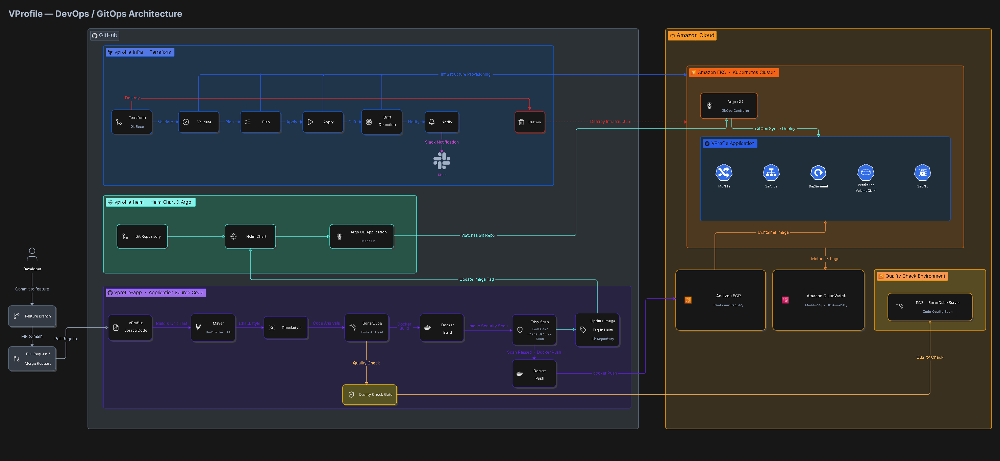
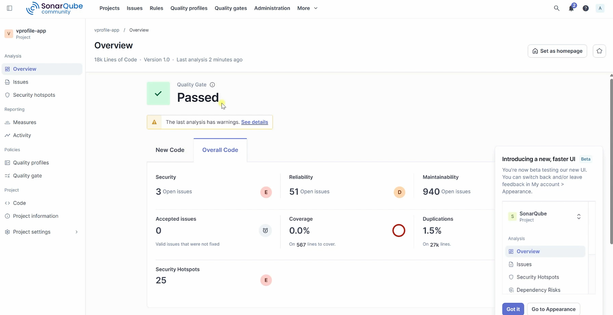
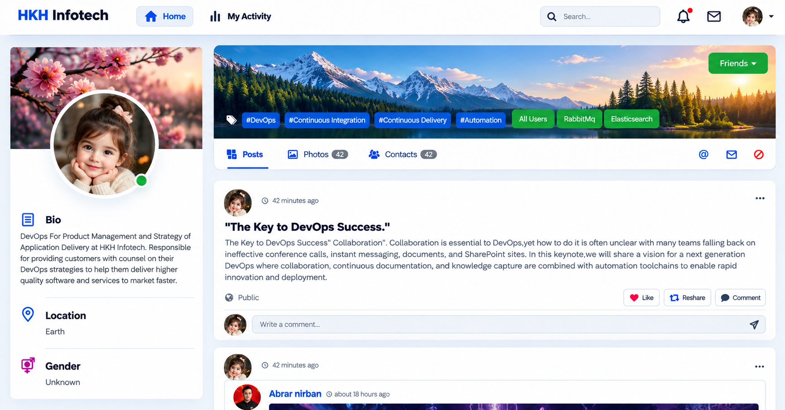

# VProfile Application | Production Platform

VProfile is a Java web application for user registration, authentication, profile management, caching, message-broker checks, and Elasticsearch-backed user operations. This repository is the **application** component of the wider Production Platform: it contains the source code, container definitions, and GitHub Actions workflow that validates pull requests, publishes an image after a `main` push, and updates a separate Helm repository.

## Environment Availability Notice

> **Note:** This is a portfolio project, and some AWS resources are intentionally stopped when not in use to avoid unnecessary costs.
>
> Certain CI/CD workflow runs may fail when required external services are unavailable. For example, pull-request validation requires a reachable SonarQube server, while image publishing depends on valid AWS credentials and Amazon ECR access.
>
> A failed workflow run does not necessarily indicate an issue with the workflow configuration. The exact failure step must be reviewed to determine whether the cause is an unavailable service, an authentication issue, or a configuration problem.
>
> AWS resources are not kept running continuously for cost optimization. Full end-to-end deployment can be verified when the required services and infrastructure are available.

The surrounding repositories have distinct responsibilities:

| Repository | Responsibility |
| --- | --- |
| [vprofile-app](https://github.com/7azeeem/vprofile-app) | Application code, Dockerfiles, SonarQube configuration, and the CI/CD workflow. |
| [vprofile-infra](https://github.com/7azeeem/vprofile-infra) | Terraform-based AWS infrastructure configuration, including the EKS cluster. |
| [vprofile-helm](https://github.com/7azeeem/vprofile-helm) | Helm values/templates and Argo CD application configuration—the desired deployment state. |

## System architecture



The diagram illustrates the intended end-to-end flow: a pull request is validated in the application repository; an approved `main` change produces a container image; the workflow records its image/tag in the Helm repository; and Argo CD observes the Helm repository and reconciles that desired state to Amazon EKS. Terraform configuration is kept separate from application delivery.

The diagram also depicts CloudWatch and Slack. They are **not configured by the GitHub Actions workflow in this repository**, so they should be treated as platform intent rather than confirmed application-pipeline stages.

## Application overview

This is a Maven-packaged **WAR** application (`com.visualpathit:vprofile:v2`), not a Spring Boot executable JAR. It uses XML-based Spring configuration and JSP views, with a Tomcat runtime image. The Maven compiler target is Java 17; the workflow and container build use Java 21.

The application includes:

- Spring MVC controllers and JSP views for login, registration, user listing, and profile updates.
- Spring Security form login with a database-backed user-details service and BCrypt password encoding.
- Spring Data JPA/Hibernate persistence for MySQL.
- Memcached access for user retrieval caching.
- RabbitMQ connectivity and producer/consumer services.
- Elasticsearch REST-client operations for indexing, reading, updating, and deleting user data.
- Multipart file-upload support and Logback/Log4j dependencies.

Key configuration is loaded from `src/main/resources/application.properties`; the Spring root context imports the MVC, data, RabbitMQ, and security XML configuration under `src/main/webapp/WEB-INF`.

## CI/CD pipeline

The single workflow, [`.github/workflows/ci.yml`](.github/workflows/ci.yml), has two event-specific paths.

```text
Pull request to main
  → Maven clean/verify + Checkstyle report
  → SonarQube scan
  → wait for SonarQube Quality Gate

Push to main
  → build container image
  → Trivy image scan (HIGH, CRITICAL; exit code 1)
  → authenticate to Amazon ECR and push SHA + latest tags
  → update Helm app.image and app.tag
  → Argo CD is intended to synchronize the Helm repository to EKS
```

### Pull-request validation

For pull requests targeting `main`, the `build-and-sonar` job checks out full history, sets up Temurin JDK 21, caches Maven and Sonar scanner dependencies, then runs:

```bash
mvn clean verify checkstyle:checkstyle -B
```

It then runs `sonarsource/sonarqube-scan-action@v2` and waits up to 600 seconds with `sonarsource/sonarqube-quality-gate-action@v1.1.0`. A failed Maven command, scanner step, or Quality Gate fails this job. Whether that failure actually prevents merging is controlled by GitHub branch-protection rules, which are outside this repository.

### Post-merge image publishing

Only a push to `main` runs `docker-build-push` and `update-helm`; SonarQube is not re-run in that push path. The workflow derives an immutable tag from the first seven characters of `GITHUB_SHA`, then also publishes `latest`. The short SHA tag provides a direct link from a deployed image to the source revision; `latest` is a moving convenience tag.

The workflow creates the configured ECR repository if it is absent, gets an ECR login password through the AWS CLI, and pushes both tags after the Trivy scan succeeds.

## Build and test locally

### Local requirements

- JDK 17 to match `maven.compiler.source` / `maven.compiler.target` in `pom.xml`. JDK 21 is used by the hosted workflow and Docker build.
- Maven 3.x (the repository does not include Maven Wrapper files or a required Maven version).
- MySQL reachable with the connection settings you supply.
- Optional runtime services for the corresponding features: Memcached, RabbitMQ, and Elasticsearch.

Build and test:

```bash
git clone https://github.com/7azeeem/vprofile-app.git
cd vprofile-app
mvn clean verify
```

Generate the same Checkstyle report requested by CI:

```bash
mvn clean verify checkstyle:checkstyle -B
```

The build produces `target/vprofile-v2.war`. Maven Surefire normally writes unit-test reports under `target/surefire-reports/`. The configured `jetty-maven-plugin` can be invoked with `mvn jetty:run` for a development run after dependencies are reachable. A failed compilation, test, or Maven plugin execution returns a non-zero status and stops the corresponding CI job.

### Local service configuration

The application reads connection settings from `src/main/resources/application.properties`. Use environment-specific, non-committed configuration or a secure secret-management mechanism for real deployments. Import `src/main/resources/db_backup.sql` into a local MySQL `accounts` database if sample schema/data are required:

```bash
mysql -u <user> -p accounts < src/main/resources/db_backup.sql
```

The repository currently contains database and broker credentials in configuration and container/Helm files. Treat these as a security remediation item: replace committed credentials with injected secrets before using this platform beyond a controlled demonstration environment.

## Code quality with SonarQube

The workflow passes `SONAR_TOKEN` and `SONAR_HOST_URL` to the SonarQube scan and Quality Gate actions. The existing [`sonar-project.properties.txt`](sonar-project.properties.txt) declares the project key/name, `src/` as sources, `target/classes` as Java binaries, and expected Surefire, JaCoCo, and Checkstyle report locations.

> **Configuration gap:** the workflow cache and SonarQube action refer to `sonar-project.properties`, but the committed file is named `sonar-project.properties.txt`. With the file in its present name, automatic property-file discovery is not assured. In addition, JaCoCo is commented out in `pom.xml`, so its XML coverage path is configured but not currently generated by Maven. Rename or explicitly reference the Sonar properties file and enable/configure JaCoCo if coverage reporting is required.

The image below is a supplied, historical capture showing a passed Quality Gate. It is not live project status, and its displayed issue/coverage metrics must not be treated as current.



## Application and image security

The confirmed image-security control is an inline Trivy command in the post-merge Docker job:

```bash
docker run --rm -v /var/run/docker.sock:/var/run/docker.sock \
  aquasec/trivy:latest image --exit-code 1 --severity HIGH,CRITICAL <image>:<short-sha>
```

This scans the built container image, not the application filesystem or repository source. `--exit-code 1` means HIGH or CRITICAL findings fail the job, so neither image tag is pushed and the Helm update cannot begin. The workflow uses GitHub secrets for the Sonar token, AWS access keys, and Helm-repository credentials; their values are not present in this README.

Current hardening opportunities include pinning the Trivy container by digest/version, using GitHub Actions OIDC with short-lived AWS credentials instead of long-lived access keys, and removing plaintext application/deployment credentials from version control.

## Docker image publishing

The push workflow uses `Docker-files/app/multistage/Dockerfile`, creates `<account>.dkr.ecr.<region>.amazonaws.com/<ECR_REPOSITORY>`, and tags the result with both `<short-sha>` and `latest`.

> **Build-source warning:** this multistage Dockerfile clones `https://github.com/hkhcoder/vprofile-project.git`, checks out its `docker` branch, and builds that clone. It does not copy or build the workflow checkout. Therefore, the ECR image may not correspond to the commit that triggered this repository’s workflow. Update the Dockerfile to build the checked-out source before relying on SHA tag traceability.

`Docker-files/app/Dockerfile` is a separate runtime-only Dockerfile that expects an already-built `target/vprofile-v2.war`; it is not the Dockerfile selected by the workflow.

## GitOps integration

After a successful image push, `update-helm` clones:

```text
https://<HELM_REPO_USER>:<GITOPS_PAT>@github.com/<repository-owner>/<HELM_REPO_NAME>.git
```

It uses `yq` to update these fields in `helm/vprofile/values.yaml`:

```yaml
app:
  image: <full ECR image name>
  tag: <seven-character Git SHA>
```

The job commits only when a values change exists and pushes to the Helm repository’s `main` branch. In GitOps terms, that commit is the intended deployment version; Argo CD—not this CI workflow—performs reconciliation to the configured Kubernetes destination.

> **Deployment alignment gap:** the checked-out Helm repository contains `helm/vprofile/values.yaml`, which matches the workflow update target. Its Argo CD Application manifest, however, declares `path: helm/vprofile-chart` and references `devops4sure/vprofile-helm`, whereas the local Helm remote is `7azeeem/vprofile-helm`. The declared chart path is not present in the inspected Helm checkout. Resolve the repository/path mismatch before assuming Argo CD will deploy the values commits.

## Application UI

The supplied screenshot shows the VProfile social-style dashboard, including profile information, post navigation, and DevOps-oriented content. It demonstrates a rendered UI only; it does not prove that every configured backend service is healthy.



## Technology stack

| Category | Confirmed technology/configuration |
| --- | --- |
| Application | Java, Spring MVC, Spring Security, Spring Data JPA, Hibernate, JSP/JSTL |
| Persistence and services | MySQL, Memcached, RabbitMQ, Elasticsearch REST High Level Client |
| Build and tests | Maven, WAR packaging, JUnit 4/JUnit Jupiter, Mockito, Spring Test, Jetty Maven Plugin |
| CI/CD | GitHub Actions, Maven cache, Docker |
| Code quality | Checkstyle report generation, SonarQube scan and Quality Gate action |
| Image security | Trivy image scan for HIGH and CRITICAL findings |
| Image registry | Amazon ECR / AWS CLI |
| GitOps | Helm values update, Argo CD manifest in the Helm repository |
| Runtime | Tomcat 10 (Docker), Amazon EKS intended by the platform configuration |

## GitHub Actions configuration

Configure these repository values and secrets before running the workflow. Do not commit their values.

| Type | Name | Purpose |
| --- | --- | --- |
| Variable | `AWS_REGION` | Region used for AWS credential configuration and ECR registry construction. |
| Variable | `ECR_REPOSITORY` | ECR repository name to create/use. |
| Variable | `HELM_REPO_NAME` | Helm repository name cloned for the GitOps update. |
| Variable | `SONAR_HOST_URL` | SonarQube server URL. |
| Secret | `SONAR_TOKEN` | Authentication for the SonarQube scan and Quality Gate query. |
| Secret | `AWS_ACCESS_KEY_ID` | Current workflow AWS credential input. |
| Secret | `AWS_SECRET_ACCESS_KEY` | Current workflow AWS credential input. |
| Secret | `HELM_REPO_USER` | Username embedded in the Helm repository clone URL. |
| Secret | `GITOPS_PAT` | Token used to clone and push the Helm repository. |

The current AWS action is configured with long-lived access-key secrets. GitHub Actions OIDC and an AWS role are the recommended replacement, but OIDC is not implemented in the checked-in workflow.

## Troubleshooting

| Symptom | Check |
| --- | --- |
| Maven or unit-test job fails | Reproduce with `mvn clean verify`; inspect `target/surefire-reports/` when it exists and resolve compilation/test failures. |
| Checkstyle report is missing | Run `mvn clean verify checkstyle:checkstyle -B`; ensure the Checkstyle goal completes before SonarQube reads the configured report path. |
| SonarQube cannot analyze or Quality Gate times out | Confirm `SONAR_HOST_URL` is reachable from GitHub-hosted runners and `SONAR_TOKEN` is valid. Also resolve the `sonar-project.properties.txt` filename mismatch. |
| Docker build succeeds but contains unexpected code | The selected multistage Dockerfile clones an external repository/branch. Replace that behavior with a build of the checkout. |
| Trivy stops publishing | Review HIGH/CRITICAL image findings; because the scan uses exit code 1, no ECR push occurs until it passes. |
| ECR authentication/push fails | Verify `AWS_REGION`, `ECR_REPOSITORY`, AWS secret permissions, and that the configured identity can create repositories and push images. |
| Helm update cannot clone or push | Check `HELM_REPO_NAME`, `HELM_REPO_USER`, `GITOPS_PAT`, and write access to the destination Helm repository. |
| Helm commit exists but no deployment changes | Correct the Argo CD repository/chart-path mismatch, then review Argo CD application health and synchronization. |

## Known gaps and follow-up work

- The workflow contains no Slack notification step despite the architecture image showing Slack.
- No source/dependency scan, SBOM generation, or image-signing step is implemented; only the built image receives a Trivy scan.
- JaCoCo coverage is configured in Sonar properties but disabled in Maven.
- The application and deployment configuration contain plaintext credentials that should be externalized.
- The multi-stage image build and Argo CD chart reference require alignment to make the intended commit-to-deployment traceability real.
